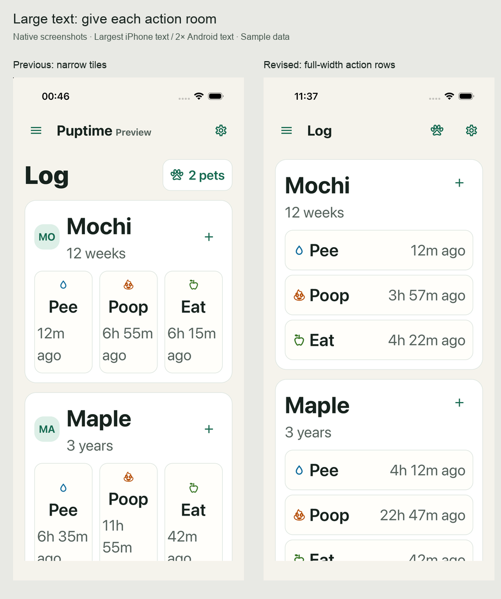
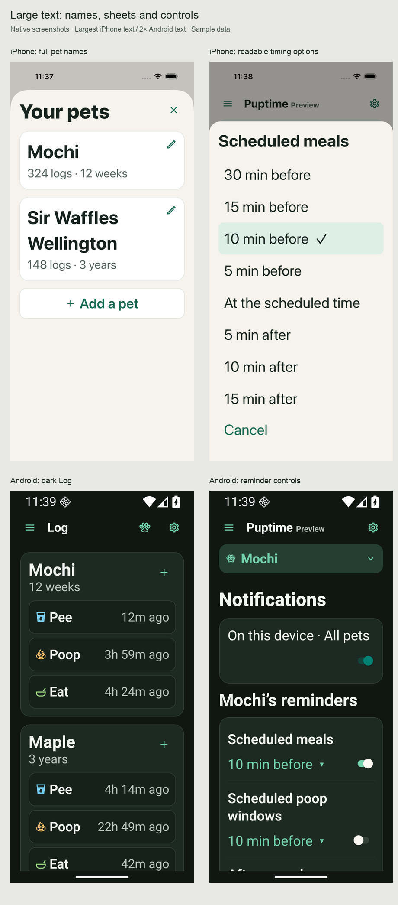
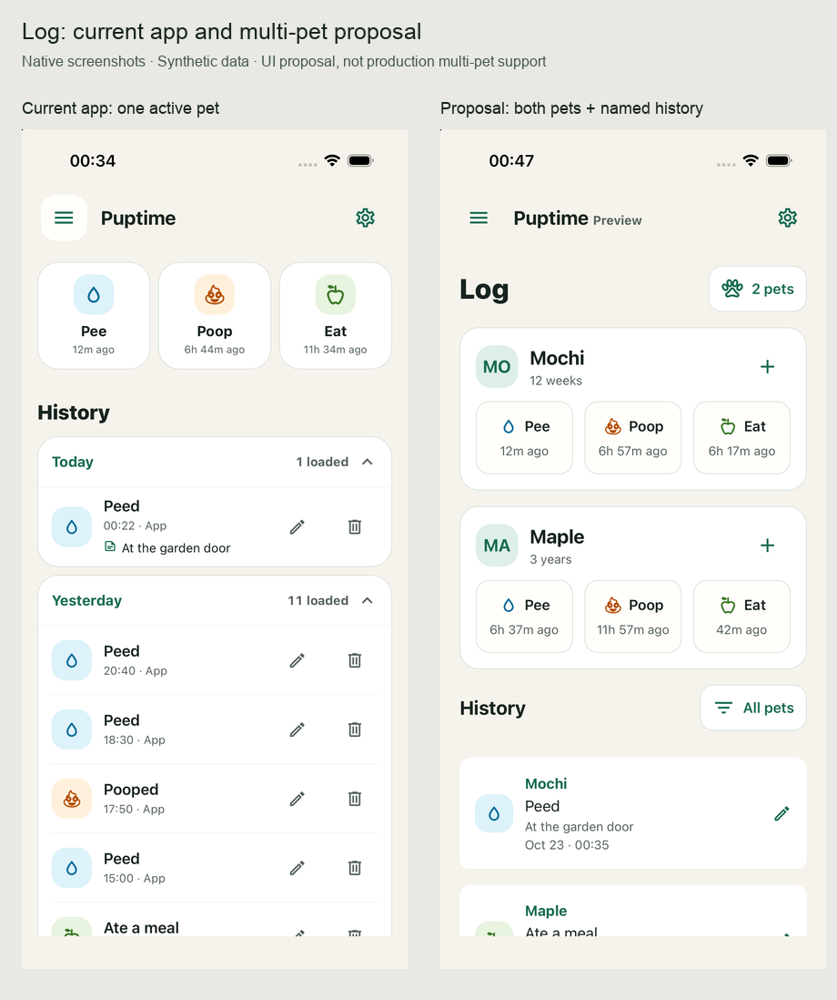
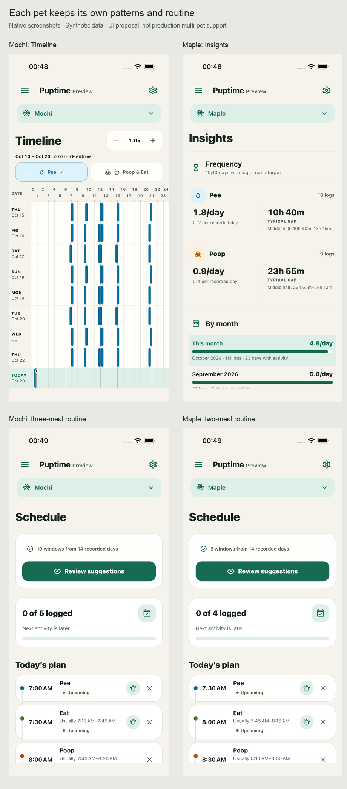
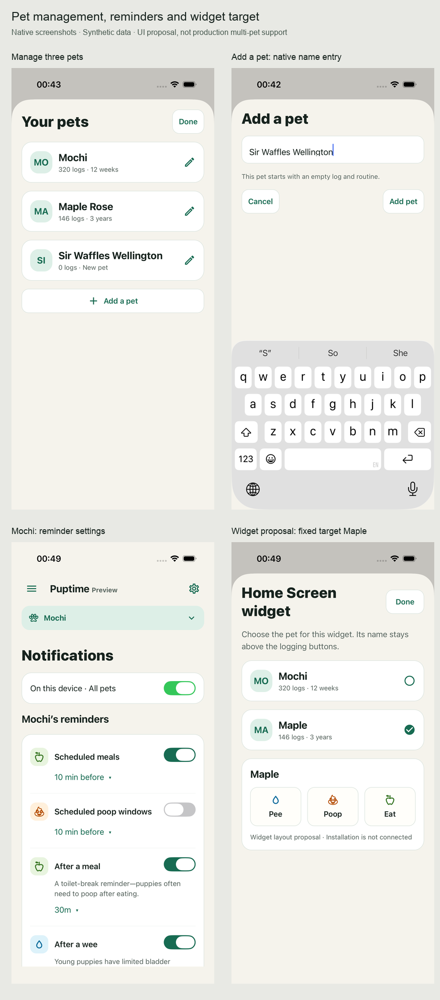
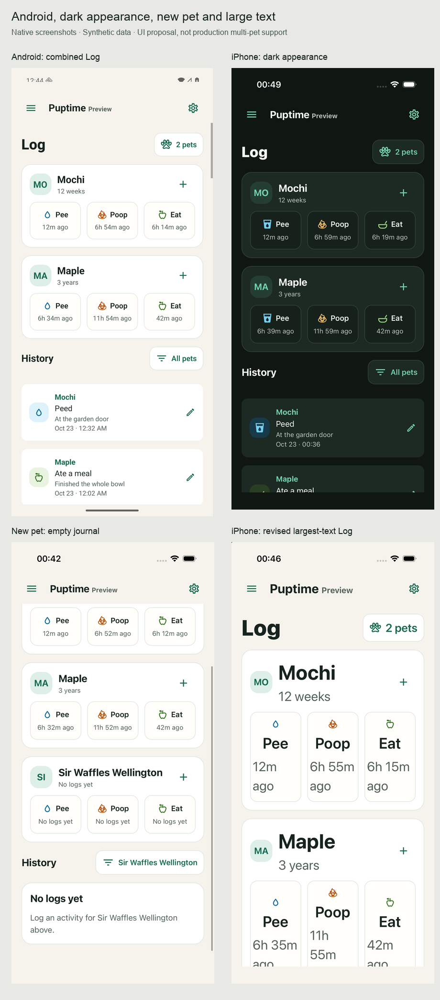
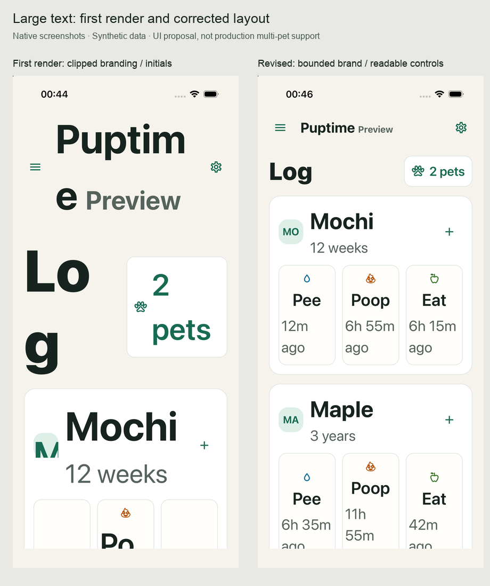

# Multiple-pet UI audit — 23 October 2026

## Status

The production app still presents one puppy. Multiple-pet **storage foundations** exist; a usable multiple-pet **product flow** does not. This PR adds a separate native, interactive design preview, not production multi-pet support. `index.ts` and the production app are unchanged. Preview records live in memory and reset on restart. The preview never connects an account or schedules system notifications.

The direction follows `RELEASE_PLAN.md`: both pets' actions together on Log; one selected pet in Timeline, Insights and Schedule. Examples use Mochi, a puppy, and Maple, an adult, with different routines and 30 days of synthetic history. A third pet exercises long names and empty states.

## Three material findings

1. **There is no way to reach multiple-pet data from the app.** `runtime.native.ts` opens a singleton runtime around `active_pet_id`; `App.tsx` loads that runtime's activity, schedule and history. Settings provides a single puppy name editor. The preview adds pet management, a named action row for each pet, a combined history, and an explicit selector above individual views.
2. **A selector alone would hide incorrect ownership in several workflows.** `PuppyEvent` has no pet ID outside its repository scope; quick actions, undo, log editors and widget pending events currently rely on the one runtime. Account association displays `account.pets[0]`. The preview carries pet identity alongside each history item, keys rows by pet and event, names logging confirmations and editors, scopes undo to its original pet, and keeps selection visible. Production must carry that identity end to end rather than changing the global active pet around asynchronous writes.
3. **Reminders and widgets are not ready for several pets.** Custom one-off reminders already carry `petId`, but routine/potty scheduling takes one schedule/history, notification preferences are device-wide settings, and widget update props do not identify a target pet. The preview separates the device notification switch from each pet's timing rules and shows a fixed, named widget target. Production needs per-pet scheduling, cancellation, notification payloads and widget routing before enabling this design.

## Full surface audit

| Surface | Current implementation | Preview / required behavior |
|---|---|---|
| Initial setup | One puppy profile | Keep first-pet setup short; expose Add a pet afterward. Additional pets start with an empty log and routine. Existing onboarding is unchanged. |
| Navigation | No pet context | Pets is a main navigation destination with a full pet list and add/edit screens. Log is household-wide. Individual views retain a visible pet selector across navigation. Learn remains shared. |
| Log quick actions | Three actions for the active puppy | Two named pet rows, each with its own latest timestamps; extra activities remain attached to that row. |
| History | One pet's day groups | Combined chronological list with a pet name on every entry; All pets / individual filtering. Production should preserve day grouping and paged queries. Preview uses a virtualized list. |
| Add, edit, undo | Implicit active puppy | Pet ID remains attached to the original action. Only the affected pet's event changes. The preview reuses the production activity/time/note editor and demonstrates undo and confirmed deletion; revision history and production persistence still need multi-pet wiring. |
| Timeline | One history and routine | Existing native chart receives only the selected pet's events/windows. Switching resets transient chart detail state. |
| Insights | One pet's statistics | Existing native analytics receives only selected-pet history. No household average that combines different animals. |
| Schedule / learning | One routine and history | Existing routine editor and suggestions use selected-pet data. Mochi has three meals; Maple has two. New pet has no example routine silently applied. |
| Notifications | Device delivery switch; one runtime's recurring rules | One device permission/delivery choice, per-pet timing rules, pet names in delivered messages. Preview toggles modify memory only. |
| One-off reminders | Pet ID exists in payload | Preserve pet-specific list/cancel behavior; add pet name to delivery and route opening to that pet. Existing production implementation still needs multi-pet UI qualification. |
| Widgets | One unlabelled target | Bind each widget instance to a fixed pet ID; show its name. Changing the app's selected pet must not retarget a widget. Screenshot is an in-app layout proposal, not an installed widget. |
| Active naps | Scoped by current repository | Preserve one running nap per pet, allow different pets to nap simultaneously, and route widget completion to the correct pet. Not implemented by this preview's extra-activity sample buttons. |
| Pet settings | Rename the current puppy | Manage names on the dedicated Pets page. Full-page forms return to that list after save or cancel; long names wrap. This proposal requires distinct display names/nicknames to keep logs unambiguous. No destructive pet removal is proposed. |
| Device settings | Appearance, language, widget actions | Appearance and language remain shared. Widget target/action preferences need instance/pet ownership. Preview demonstrates shared appearance. |
| Local backups | Already retain/recover all dogs by original ID | Preserve all-pet recovery and per-pet limits; present names when choosing a snapshot. Existing recovery is not exercised by the preview. |
| CSV export/import | Active pet; CSV has event IDs but no pet mapping | Confirm destination pet before import; name source pet in export UI/file. Define an explicit multi-pet archive format before offering household export. Preview import explains its sample-only behavior; Settings names the selected pet and exports only its synthetic history. |
| Cloud / account | One runtime; first cloud pet association | One account, multiple explicit local-to-cloud associations. Show the chosen dog's summary before combining/restoring. Requires backend/client qualification; the preview does not simulate a successful cloud connection. |
| Revision history | Repository-scoped events | Keep pet context visible in recent changes and restores; preserve composite identity even when event IDs collide. Not wired into the preview. |
| Learn / care guides | Shared content | Keep shared. No pet picker that implies advice has been personalized. Existing screen is reused. |
| Empty / validation | No add-pet flow | Third pet has zero logs and no routine. Blank and duplicate display names retain the form with inline errors. Cancel does not add a pet. |
| Accessibility / layout | Native framework and theme tokens | Native sheets, inputs, switches and 48-point actions; full names rather than color alone; two-letter monograms distinguish Mochi/Maple. Verify narrow, dark, large-text and landscape states. |

## Design refinements made after rendering

- Kept each pet's name directly beside its actions; compact action rows leave room for history on a phone.
- Used two-letter monograms after the first render showed identical M avatars for Mochi and Maple.
- Moved management out of the selector sheet and Settings into a dedicated Pets destination. The quick selector links to that page. Add/edit forms use the app header and Back navigation, with blank/duplicate-name errors. Saving stays on the pet list and preserves the selected pet and history filter.
- Kept editor draft state inside the editor and memoized history rows, with stable callbacks and composite pet/event keys.
- At the largest iPhone system text setting, the first preview wrapped the brand into several lines and clipped avatar initials. Bounded decorative branding and compact controls separately from body text; body copy still grows to twice its base size. The revised native Log was captured at that setting. Full accessibility qualification of the reused analysis/routine screens remains production work.

## Navigation integration after #151

The preview now follows the production navigation revision: compact screen titles in the top bar, one-tap Log/Timeline switching, contextual Back, and CSV controls in Settings with an explicit pet selector. Export reads only the selected in-memory sample history. The production entry point remains unchanged.

## Production implementation boundary

This is a reviewable UI proposal. Shipping it requires explicit pet-scoped writes/queries throughout the app, a persistent pet-management API, scoped notification preferences and scheduling, widget identity, account association, migrations and recovery qualification. Do not promote the preview entry point as the production entry point.

Run and screenshot instructions, automated flows, and the Android row-render observer are in `scripts/multi-pet-preview/`. Native captures and the gallery are under `output/multi-pet-audit/` in this worktree; selected contact sheets accompany this document.

## Verification

- All 462 existing and new Node unit tests passed. General, iOS and Android TypeScript checks passed.
- Native iPhone flows covered all main views, pet selection, pet-specific logging and undo, filtering, add/rename, duplicate-name validation, empty history and empty routine. A separate check exercised rename from Settings and cancellation.
- The preview now reuses the full production editor for activity, time, and notes. The post-log action is labeled Edit. Fresh Android checks cover reopening saved edits and confirmed deletion; the main app check preserves all 1,000 original fixture entries. These editor changes were not rerun on iOS.
- Fresh Android Pets checks cover full-page add/edit, validation, cancellation, contextual and system Back, retained selection, dark mode, 375 dp at 2× text and landscape. The production SQLite files remain unchanged. iOS pet-management screens were not rerun after replacing the sheet.
- The Android UI rendered with 30 days of distinct history for two pets. The render observer tracked 83 history rows: opening the editor redrew zero rows; autosaving changed only the edited row.
- Captured iPhone light/dark, iPad portrait, Android light/dark, a 375 dp Android viewport, 2× Android text, the largest iPhone accessibility text category, and a landscape Android viewport. These are targeted preview checks, not full accessibility certification of the existing app.
- System notification delivery, installed widget interactions, cloud sync, persistent pet creation/switching, and recovery across multiple pets were not verified by this UI proposal.

## Screenshots

### Large-text follow-up

The revised phone layout uses full-width activity rows once enlarged text has less than 300 points of effective horizontal room. Times stay beside their activity rather than wrapping down narrow tiles. The Log title and pet-management control move into the navigation header. Decorative avatars give way to full pet names; large-text history notes have no two-line limit. Wide tablet and landscape layouts retain the grid.

Pet sheets use an accessible close control beside a flexible heading. The shared reminder controls give their label a full row and align timing choices with native switches below it. Reminder body text scales up to 2× and sheet headings to 1.5×, matching the preview's existing type hierarchy. The shared navigation drawer uses the same limits and pins its heading/close control while its destinations scroll. Inputs also retain 2× scaling.

Validation includes the largest iPhone accessibility text category, Android at 375 dp with 2× text, long names, light/dark, landscape, reminder selection, logging/undo, and note editing against populated history. The opt-in multi-pet preview remains separate from the production entry point; reminder-control and drawer refinements apply to the native app too.

Follow-up checks passed all 462 Node tests and all three TypeScript configurations. The enlarged Android history probe observed 55 rows: opening and typing redrew none, and saving redrew only the edited row. It also verified that the complete multi-line note remains visible after saving.

