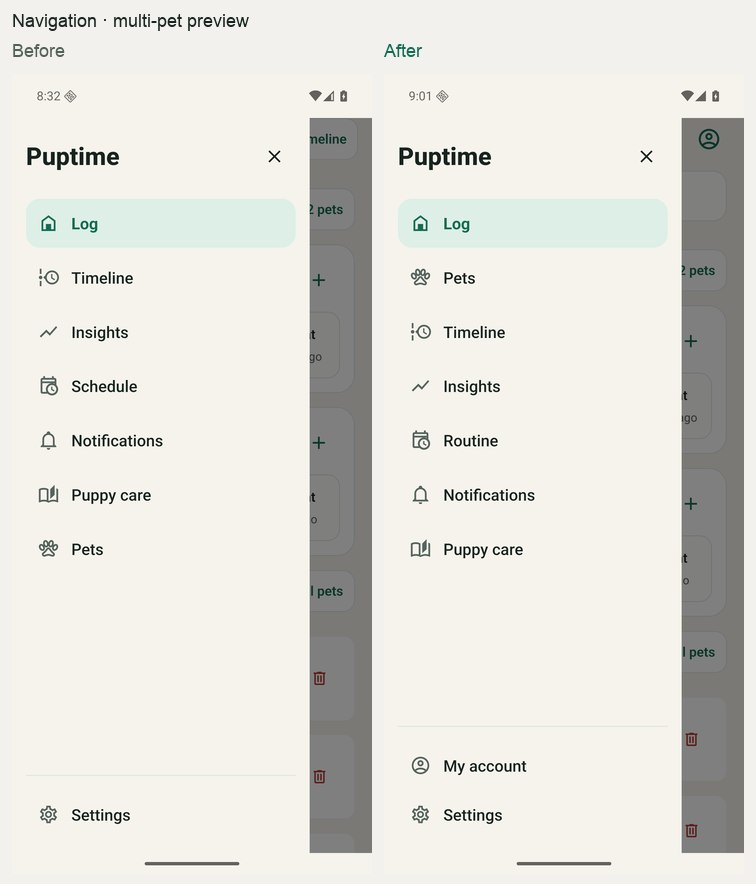
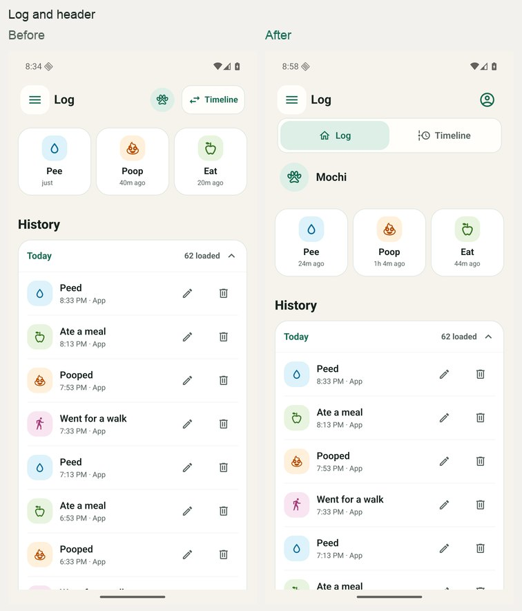
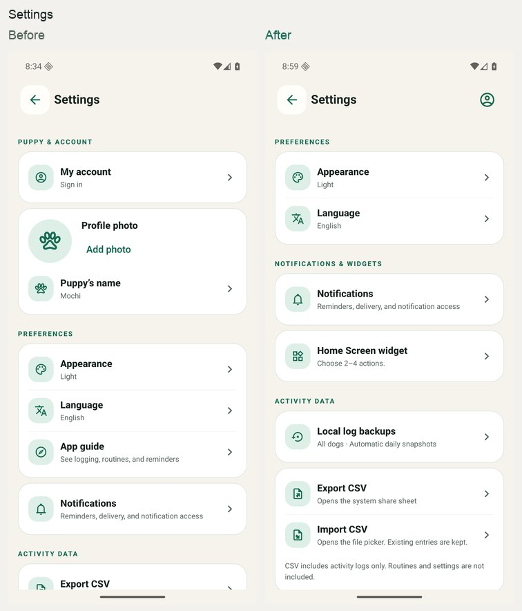
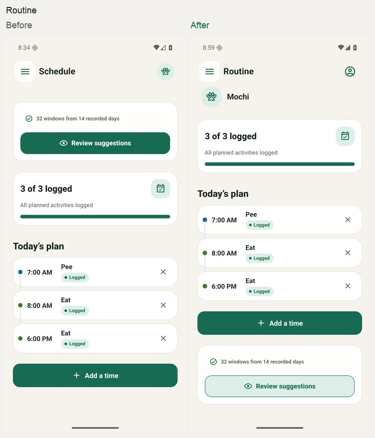
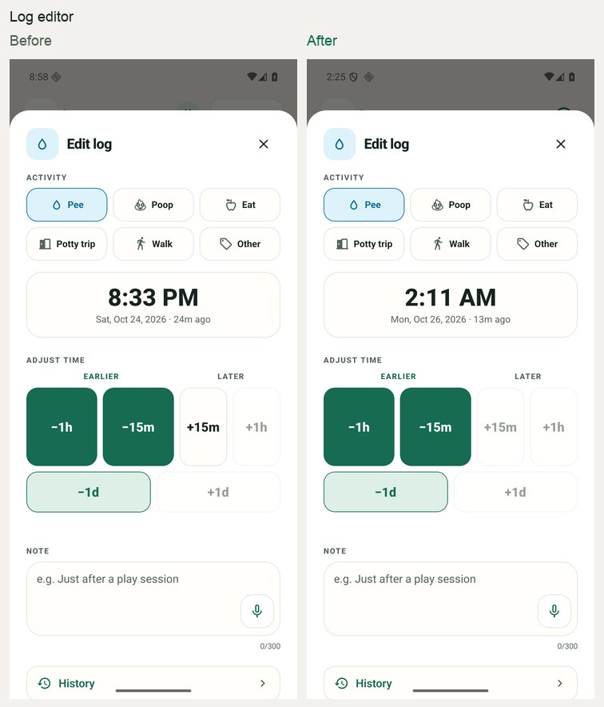

# UI hierarchy changes

The baseline is `main` at `55d6f64`, after the navigation, pet-photo and account PRs merged. Screenshots use synthetic data on the dedicated Android emulator. Before is on the left; after is on the right. [Open all 18 comparisons](ui-hierarchy/index.html).

## Navigation and page decisions

| Area | Result |
| --- | --- |
| Drawer | Log → Pets → Timeline → Insights → Routine → Notifications → Puppy care. Account and Settings form a separate footer. |
| Header | Account is the top-right person icon. The pet photo/name appears with pet-specific content and opens Pets. Log/Timeline use a labeled switch below the header. |
| Pets | Name and photo belong in the pet profile, together with its log count. |
| Log editor | One timestamp preview, followed by the expanded Adjust time shortcuts above Note. |
| Timeline | Visible minus, reset and plus controls complement gestures; landscape places them beside the filters. |
| Insights | Existing summary-to-detail order retained; pet context remains visible. |
| Routine | With a saved routine, progress and today's plan precede suggestions. An empty routine still leads with suggestions. |
| Notifications | Device-wide delivery first, then pet context, recurring reminder controls, timing and one-off reminders. |
| Puppy care | Search precedes the featured guide and article list. |
| Settings | Preferences → Notifications & widgets → Activity data → Help & privacy. Widget customization opens its own sheet. |
| Backups | Device-only consequence, pet filter when needed, snapshots, then retention explanation. |
| Account | Available from header and drawer, with a web account-management link for signed-in users. Closing returns to the originating screen. |
| Onboarding | Starting locally precedes optional provider sign-in in the existing onboarding preview. |

Production continues to persist one pet. The existing opt-in multi-pet preview follows the same navigation hierarchy; this change does not enable multi-pet persistence or cloud sync.

## Rendered comparisons

## Verification

- General, Android and iOS TypeScript checks passed; 474 unit tests and 9 web tests passed.
- Dedicated Android navigation flow passed with 1,000 synthetic events, preserving event fields and exporting all rows to CSV.
- Production render instrumentation observed 135 event rows: opening the editor caused no row updates; saving a note updated only the edited event. Timeline details preserved unchanged date rows and tracks.
- Restored Adjust time check: the expanded shortcuts appear above Note; −15m persisted exactly 15 minutes earlier and updated only the edited event among 79 observed rows.
- Multi-pet preview render checks passed at 375dp with 2× text, including editor opening, autosave and deletion confirmation/cancellation.
- Dedicated iPhone flow passed across navigation, pet profile, Account, Settings, widget, Routine, Notifications and the log editor. Settings/widget also passed at maximum Dynamic Type.
- Reviewed narrow layouts, large text, dark appearance, reduced motion and landscape.

Screenshots of the persisted app and opt-in preview are labeled separately in the gallery. Time-relative labels can differ between captures.
