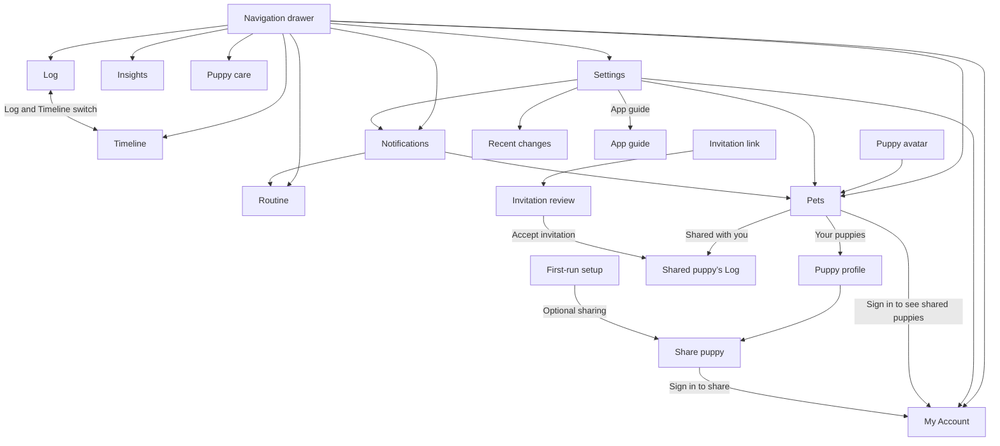
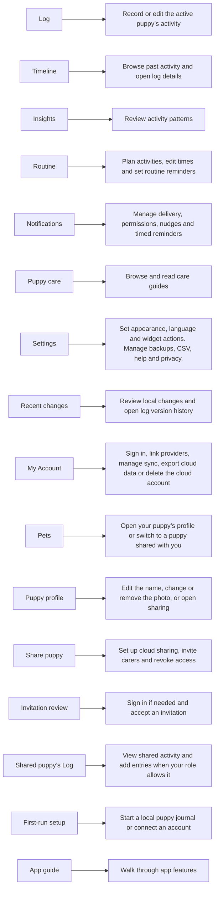

# Puptime navigation and interface audit

The puppy avatar, Settings, and the drawer lead to a small set of pages with distinct jobs. Settings is the index for app preferences. My Account is for the person and their cloud connection. Pets is the list of puppies they own or care for.

## How to reach each page on iOS

## What each page does

The Settings groups share one component for uppercase headings, card insets and separators. Search keeps data controls mounted during a transfer and shows separators only between visible rows.

The Account route keeps the caller on the navigation stack. Back returns to the drawer’s source page, Settings, or Share puppy. The account page shows compact local storage status and count. Puppy identity comparisons stay with the cloud connection review. The Apple and Google buttons use the providers’ native controls.

The profile uses a single photo control. iOS uses the system action sheet for the two photo actions, and adding or replacing a photo opens the system picker. The production journal supports one owned puppy. Additional owned puppy rows and independent journals need their own data and switching work.

The original pass also standardized the back button and heading alignment on sharing and activity history, and removed a duplicate safe-area inset from Recent changes.

## iOS verification

The navigation flow used an iPhone 17 simulator on iOS 26.5 with 360 synthetic activity logs. It exercised the Settings and avatar paths to Pets, inline name editing, photo removal and replacement, and all three paths to My Account and back.

Separate iOS fixtures passed guide replay from Settings, recovery of 21 logs into a fresh installation, and local preservation of 12 logs after cloud account deletion. The account fixtures used a local backend and disposable identities.
